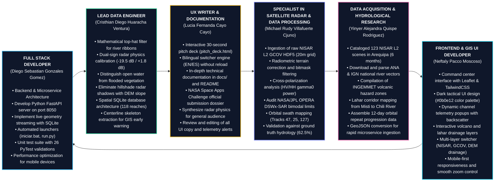

# 👥 Space Society — Team Structure & Roles
### NASA Space Apps Challenge 2026 | Project: NISAR Hydro-Lens

---

## 🧭 Workflow Diagram (Mermaid - Horizontal)

---

## 📊 Linear Workflow Diagram (Mermaid - Vertical)

```mermaid
flowchart TD
    subgraph G1["1. Full Stack Architecture & Microservice"]
        FS["<b>FULL STACK DEVELOPER</b>
        Diego Sebastian Gonzales Gomez
        • FastAPI / Python microservice on port 8050
        • Precalculated SQLite vector streaming
        • Cross-platform automation scripts (iniciar.bat, run.py)
        • 26 automated unit tests passing in PyTest"]
    end

    subgraph G2["2. Data Engineering & Mathematical Radar Kernels"]
        DE["<b>LEAD DATA ENGINEER</b>
        Cristhian Diego Huaracha Ventura
        • Multi-scale directional top-hat morphological filter (600m)
        • Radar backscatter threshold calibration (-19.5 dB / +1.8 dB)
        • DEM slope & HAND topographic radar shadow mitigation
        • Spatial SQLite database architecture (118 reaches)"]
    end

    subgraph G3["3. Remote Sensing & Satellite Ingestion"]
        SAT["<b>SPECIALIST IN SATELLITE RADAR & DATA PROCESSING</b>
        Michael Rudy Villafuerte Cjuno
        • Raw NISAR L2 GCOV HDF5 ingestion on native 20m UTM grid
        • Dual-polarization radar power analysis (HHHH and HVHV)
        • NASA/JPL OPERA DSWx-SAR algorithm audit and diagnostics
        • Orbital satellite swath mapping (Tracks 47, 25, 127)"]
    end

    subgraph G4["4. Data Acquisition & Hydrological Ground Truth"]
        DA["<b>DATA ACQUISITION & HYDROLOGICAL RESEARCH</b>
        Yinyer Alejandra Quispe Rodriguez
        • Complete catalog of 123 NISAR L2 GCOV scenes in Arequipa
        • Ground-truth baseline vectors from ANA and IGN Peru
        • Volcanic hazard zoning compilation from INGEMMET
        • Multitemporal orbital timeline records (+0d to +72d)"]
    end

    subgraph G5["5. Frontend & Tactical Command Center"]
        FE["<b>FRONTEND & GIS UI DEVELOPER</b>
        Neftaly Pacco Moscoso
        • Interactive Leaflet.js dashboard with dark tactical UI
        • Dynamic reach telemetry popups (length, width, decibels)
        • Volcano & Lahar Corridor hazard layer visualization
        • Performance optimization for mobile devices in field emergencies"]
    end

    subgraph G6["6. Scientific Technical Writing & UX"]
        UX["<b>UX WRITER & TECHNICAL DOCUMENTATION</b>
        Lucia Fernanda Cayo Cayo
        • High-resolution 30-second automated pitch deck (pitch_deck.html)
        • Zero-reload bilingual internationalization engine (EN/ES)
        • Comprehensive scientific documentation in docs/ and README
        • Official NASA Space Apps Challenge submission dossier"]
    end

    FS --> DE --> SAT --> DA --> FE --> UX --> FS
```

---

## 📋 Detailed Team Member Profiles

### 1. Diego Sebastian Gonzales Gomez
* **Role:** Full Stack Developer & Systems Architect
* **Key Contributions:**
  * Engineered the dual-service application architecture: asynchronous FastAPI/Python microservice on port `8050` paired with the local static server on port `8000`.
  * Designed lightweight geospatial vector streaming querying precalculated geometries in `data/hydro_rivers.sqlite`, enabling operation under low-bandwidth disaster conditions.
  * Automated system deployment with one-click scripts (`iniciar.bat`, `detener.bat`) and cross-platform launcher (`run.py`).
  * Implemented and maintained continuous verification suites with 26 automated unit tests passing across Python 3.10–3.13.

### 2. Cristhian Diego Huaracha Ventura
* **Role:** Lead Data Engineer & Geospatial Processing Specialist
* **Key Contributions:**
  * Developed the core mathematical top-hat morphological filter (`processing/gcov_rivers.py`) with a 600m directional structuring element to extract linear river channels.
  * Calibrated physical radar backscatter decibel thresholds to distinguish open-water specular reflection ($-19.5\text{ dB}$) from flooded canopy double-bounce ($+1.8\text{ dB}$).
  * Mitigated false positives from terrain radar shadows by integrating DEM slope and Height Above Nearest Drainage (HAND) topographic masks.
  * Structured spatial tables and indexes for 118 Peruvian river reaches across Southern Peru basins.

### 3. Michael Rudy Villafuerte Cjuno
* **Role:** Specialist in Satellite Radar & Data Processing (NISAR / SAR)
* **Key Contributions:**
  * Ingested and preprocessed raw NASA-ISRO NISAR L2 GCOV HDF5 scientific granules on their native 20m UTM grid (EPSG:32719).
  * Executed radiometrically terrain-corrected radar polarimetry, calibrating co-polarized (HHHH) and cross-polarized (HVHV) gamma-naught ($\gamma^0$) power.
  * Conducted an in-depth audit of the official NASA/JPL OPERA DSWx-SAR pipeline, diagnosing and documenting bimodal threshold failures over narrow Andean gorges.
  * Georeferenced satellite ground swaths (Tracks 47, 25, 127) for accurate spatial clipping and analysis.

### 4. Yinyer Alejandra Quispe Rodriguez
* **Role:** Data Acquisition & Hydrological Research Specialist
* **Key Contributions:**
  * Cataloged, verified, and structured 123 NASA NISAR L2 GCOV scenes covering the Arequipa department over the past 6 months (May–November 2026).
  * Downloaded, cleaned, and integrated official reference hydrology datasets from the National Water Authority (ANA) and National Geographic Institute (IGN).
  * Compiled geological hazard maps from INGEMMET and CENEPRED for Misti and Sabancaya volcanoes, delineating lahar corridors into the Chili River.
  * Structured multitemporal scenario datasets simulating 12-day orbital repeat cycles ($+0\text{d}$ to $+72\text{d}$) with discharge metrics.

### 5. Neftaly Pacco Moscoso
* **Role:** Frontend Developer & Tactical GIS UI Specialist
* **Key Contributions:**
  * Designed and built the tactical dark command center interface using Leaflet.js, ES6+, and TailwindCSS (`#0b0e12` palette).
  * Created dynamic telemetry HUDs and interactive popups presenting reach-by-reach channel properties: length, width, elongation ratio, and backscatter profile.
  * Integrated dedicated visual layers for Volcano & Lahar hazard corridors, enabling instant focus on active volcanic cones.
  * Optimized rendering pipelines and touch interactions for mobile devices and emergency field tablets.

### 6. Lucia Fernanda Cayo Cayo
* **Role:** UX Writer & Scientific Technical Documentation Lead
* **Key Contributions:**
  * Developed the zero-reload bilingual internationalization engine (`js/i18n.js`) providing seamless instant switching between English and Spanish.
  * Authored comprehensive scientific documentation, radar physics explanations, and OPERA diagnostic reports in `docs/` and `README.md`.
  * Designed the interactive 30-second automated pitch presentation (`pitch_deck.html`) complete with synchronized slide voiceover subtitles.
  * Structured and formatted the official submission dossier for the NASA Space Apps Challenge judging panel.
